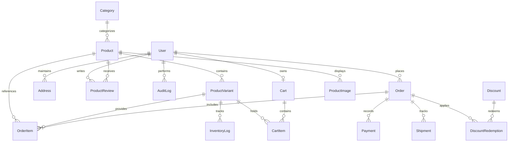

# Krag Organic — System Architecture & Database Schema

## 1. Architectural Philosophy

**Krag Organic** is engineered as a modern, high-performance, full-stack e-commerce platform built around principles of clean separation of concerns, transactional data consistency, zero raw payment card exposure, and server-enforced role-based access control.

```
┌────────────────────────────────────────────────────────────────────────┐
│                          PRESENTATION LAYER                            │
│  - Next.js 16 App Router (React 19 Server & Client Components)         │
│  - Tailwind CSS v4 design system (Forest green, warm off-white palette)│
│  - Responsive Storefront & Dedicated Admin Dashboard (/admin)          │
└──────────────────────────────────┬─────────────────────────────────────┘
                                   │
                                   ▼
┌────────────────────────────────────────────────────────────────────────┐
│                        APPLICATION & API LAYER                         │
│  - Route Handlers & Server Actions (/api/auth, /api/orders, /admin)   │
│  - Zod Input & Mutation Validation                                     │
│  - Jose JWT Session Verification & HttpOnly Cookies                    │
│  - Audit Logging System for Administrative Operations                  │
└──────────────────────────────────┬─────────────────────────────────────┘
                                   │
                                   ▼
┌────────────────────────────────────────────────────────────────────────┐
│                     PAYMENT PROVIDER ABSTRACTION                       │
│  - PaymentProvider Interface: initiatePayment() & verifyPayment()       │
│  - eSewa v2 Adapter (HMAC-SHA256 signature verification)               │
│  - Khalti v2 ePayment Adapter (Lookup verification & paisa conversion) │
│  - Cash on Delivery (COD) Doorstep Collection Adapter                  │
│  - Sandbox / Test Card Simulation Adapter                              │
└──────────────────────────────────┬─────────────────────────────────────┘
                                   │
                                   ▼
┌────────────────────────────────────────────────────────────────────────┐
│                           PERSISTENCE LAYER                            │
│  - Prisma ORM 6.4.1 Client with Type Safety                            │
│  - SQLite (Instant zero-friction local development)                    │
│  - PostgreSQL (Production ready for Neon, Supabase, RDS)                │
│  - Atomic Database Transactions ($transaction) for stock & orders      │
└────────────────────────────────────────────────────────────────────────┘
```

---

## 2. Database Models & Entity Relationships

The schema is normalized, enforces referential integrity with cascading rules where appropriate, and preserves snapshot historical data on order line items so subsequent product or price edits never alter past receipts.

### Entity Relationship Overview



### Model Specifications

1. **User**
   - Stores customer and administrator accounts.
   - Roles: `ADMIN` | `CUSTOMER` (public registration is locked to `CUSTOMER`).
   - Securely hashed passwords using `bcryptjs` (cost factor 10).

2. **Address**
   - Multiple addresses per user with `isDefaultShipping` and `isDefaultBilling` flags.
   - Domestic Nepal address fields: Full Name, Address 1, Address 2, City, State/Province, Postal Code, Country, Phone.

3. **Category**
   - Organizes supplements into: Protein Powder, Creatine & Strength, Pre-Workout & Focus, Recovery & Hydration, Daily Wellness & Botanicals.
   - Includes display orders, description, and preview imagery.

4. **Product**
   - Master supplement catalog entry.
   - Fields: Name, Slug, Subtitle, Description, Ingredients, Suggested Usage, Allergens & Disclaimers, Package Size, Base Price, Compare-At Price, Active Status, Merchandising Flags (Featured, Bestseller, New Arrival).

5. **ProductVariant**
   - Individual purchaseable SKUs (e.g., Flavor: Bourbon Vanilla, Weight: 1kg).
   - Fields: Name, Flavor, Weight, Unique SKU, Price, CompareAtPrice, Stock Count, Active Status.

6. **ProductImage**
   - Multiple images per product with `isPrimary` and `displayOrder`.

7. **InventoryLog (Stock Movement)**
   - Audit trail of stock alterations.
   - Reasons: `RESTOCK` | `DAMAGE` | `ADJUSTMENT` | `SALE` | `RETURN`.
   - Records `previousStock`, `changeQuantity`, `newStock`, and `createdByAdminId`.

8. **Order & OrderItem**
   - Atomic checkout snapshot: Preserves customer contact, physical shipping address, and item prices at the time of purchase.
   - Statuses:
     - `status`: `PENDING` | `PROCESSING` | `SHIPPED` | `DELIVERED` | `CANCELLED`
     - `paymentStatus`: `PENDING` | `PAID` | `FAILED` | `REFUNDED`
     - `fulfillmentStatus`: `UNFULFILLED` | `PARTIALLY_FULFILLED` | `FULFILLED`
   - Cancelling an order automatically restores items back into `ProductVariant.stock` and logs an `InventoryLog` entry.

9. **Payment**
   - Records transaction token, gateway response payload, status, and verified amount.

10. **Shipment**
    - Carrier name (Sundar Express, Nepal Post, Aramex, In-House), tracking number, status (`LABEL_CREATED`, `IN_TRANSIT`, `DELIVERED`), timestamps.

11. **Discount & DiscountRedemption**
    - Coupon codes (e.g. `KRAG10`, `WELCOME500`).
    - Types: `PERCENTAGE` or `FIXED_AMOUNT`.
    - Enforces minimum order subtotal, start/end dates, active toggle, and maximum usage caps.

12. **ProductReview**
    - Customer reviews with 1-5 star ratings, title, comment, and verified purchaser badge check.

13. **NewsletterSubscription**
    - Collects opt-in customer emails for health updates.

14. **AuditLog**
    - Records all administrative operations (order modifications, product CRUD, inventory restocks, promo creation) with timestamp, operator ID, and operation payload.

15. **StoreSetting**
    - Key-value configuration for store name, email, phone, free delivery threshold, standard shipping fee, and announcement marquee.
